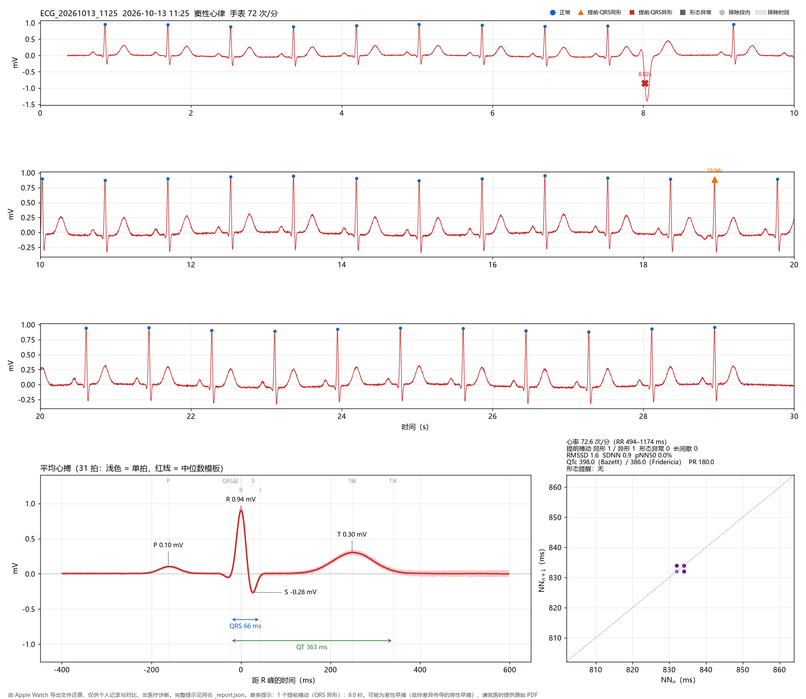
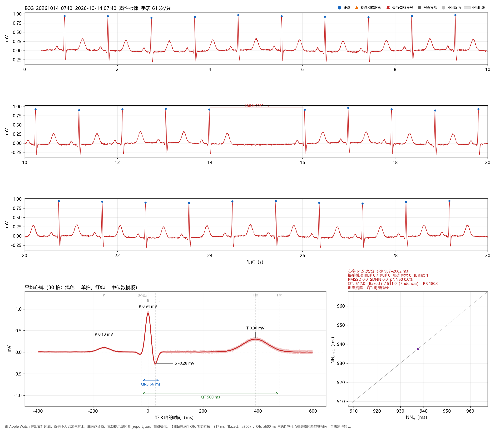

# apple_watch_ecg

[](https://github.com/Chizukuo/apple_watch_ecg/actions/workflows/tests.yml)
[](https://github.com/Chizukuo/apple_watch_ecg/releases)
[](#安装)
[](LICENSE)
[](validation/RESULTS.md)


把 Apple Watch 心电图导出的 PDF（或截图）还原成连续信号：逐拍标注节律，测量平均心搏，对 QTc、QRS、PR、ST、T 波给出有依据的形态提醒，并和手表自己的结论对照。

> [!IMPORTANT]
> 仅供个人记录与对比，**不是医疗诊断**，也不是医疗器械。出现症状或对结果有疑问时，请以医生和 12 导联心电图为准。

*Turns Apple Watch ECG PDF exports (or screenshots) back into a continuous signal, labels every beat, measures the median beat (P/PR/QRS/ST/T/QT) and raises guideline-referenced screening alerts. Personal use only — not a medical device or diagnosis. Docs are in Chinese.*



<sub>合成记录（不是真人数据）：8.02 秒处的室性早搏标为“提前·QRS异形”（红叉），18.94 秒处的房性早搏标为“提前·QRS同形”（橙色三角）。下方是标好测量点的平均心搏和 Poincaré 图。</sub>

## 目录

- [功能](#功能)
- [安装](#安装)
- [使用](#使用)
- [输出](#输出)
- [隐私](#隐私)
- [验证](#验证)
- [工作原理](#工作原理)
- [形态提醒](#形态提醒)
- [已知局限](#已知局限)
- [测试](#测试)
- [许可证](#许可证)

## 功能

| | |
|---|---|
| **提取** | 矢量 PDF 按网格换算时间，按定标方波换算电压；截图、扫描件走光栅识别 |
| **逐拍标注** | 正常 / 提前·QRS同形 / 提前·QRS异形 / 形态异常 / 排除段内 |
| **节律事件** | 长间歇（区分代偿间歇）、二联律样、RR 长短交替；体动伪影自动排除 |
| **平均心搏** | P、PR、QRS、ST、T、QT、QTc（Bazett / Fridericia），测不准的量会明确标注 |
| **形态提醒** | QTc 延长 / 缩短、QRS 增宽、PR 延长 / 偏短、ST 抬高 / 压低、T 波倒置，分“关注”和“建议就医”两级 |
| **HRV** | RMSSD、SDNN、pNN50、SD1 / SD2、Poincaré 图 |
| **和手表对照** | 心率、分类（按算法版本的心率范围）、年龄适用范围 |
| **隐私** | 默认输出不含姓名、出生日期和源文件名 |

## 安装

需要 Python ≥ 3.11。

```bash
git clone https://github.com/Chizukuo/apple_watch_ecg.git
cd apple_watch_ecg
pip install -r requirements.txt
```

看板里的中文需要系统装有中文字体（Windows 自带微软雅黑，macOS 自带苹方）。Linux 请安装 Noto Sans CJK（如 `apt install fonts-noto-cjk`），否则中文会显示成方框。

## 使用

先用仓库里的合成记录试跑：

```bash
python apple_watch_ecg.py examples/synthetic_demo.pdf -o out
```

处理自己的记录（在 iPhone“健康”App 里打开某次心电图 → “为医生导出 PDF”）：

```bash
python apple_watch_ecg.py 记录.pdf -o out
python apple_watch_ecg.py 文件夹/ -o out      # 批量，另外输出按记录时间排序的 summary.csv
```

| 参数 | 作用 |
|---|---|
| `-o, --output` | 输出目录，默认 `./ecg_output` |
| `--sex {male,female,unknown}` | QTc 延长的阈值按性别：男 450 / 女 460 ms；默认 `unknown`，按 450 |
| `--placement {wrist,other}` | 手表没戴在手腕上（贴胸口、腹部、肋骨等）时用 `other`：不做 ST / T 波提醒 |
| `--exclude 0-4,27.5-30` | 手动排除时段（秒），只能用于单个文件 |
| `--include-identity` | 在报告中保留姓名、出生日期和源文件名 |

## 输出

每条记录输出三个文件，按 PDF 里的记录时间命名，例如 `ECG_20261013_1125`：

| 文件 | 内容 |
|---|---|
| `*_report.json` | 手表信息、节律（逐拍标注、事件）、HRV、平均心搏测量、形态提醒（`morphology_alerts`）、提示 |
| `*_signal.csv` | 512 Hz 连续电压、截断标记、每拍的标注 |
| `*_dashboard.png` | 三行波形（按类型标出每一拍）、标好测量点的平均心搏、Poincaré 图、形态提醒（有“建议就医”时标红） |

有“建议就医”级别的提醒时，看板右下角的摘要会变红。下图是另一份合成记录，含一次窦性停搏和 QTc 明显延长：



<sub>合成记录：14.0–16.1 秒的长间歇（2062 ms，约为参考间期的 2.2 倍）；T 波后移使 QTc 达到 517 ms，触发“建议就医”。</sub>

## 隐私

- 默认输出**不含**姓名、出生日期和源文件名（Apple 导出的文件名里带姓名），处理失败时的提示也不含；需要时加 `--include-identity`。
- 出生日期只用于计算“记录时年龄”，报告里只出现年龄。
- 没有文字层的图片按文件内容哈希命名。导出时间按本机时区换算。
- `.gitignore` 默认忽略所有 PDF、图片、CSV、JSON 和输出文件夹，只放行 `examples/synthetic_*`。不要把自己的记录放进 `tests/`。

## 验证

| 数据 | 结果 |
|---|---|
| MIT-BIH 心律失常数据库：心搏检出（44 条记录、2640 个 30 秒窗口） | 灵敏度 99.17%，阳性预测值 99.31% |
| MIT-BIH：含室性早搏的窗口有提示 | 98.0% |
| MIT-BIH：含室上性早搏的窗口有提示（非房颤） | 83.6%（逐拍只有 33%，门槛有意定得保守） |
| MIT-BIH：纯正常窗口出现任何节律提示 | 13.4%（提前 4.5%，长间歇 1.4%，形态异常 10.3%，多来自噪声大的动态心电图） |
| MIT-BIH：QRS 增宽提醒 | 左束支阻滞 70%，右束支阻滞 39%，正常传导误报 1.2% |
| 合成正常记录（96 份，心率 52–125，不同程度的呼吸性心律不齐、噪声、基线漂移） | 无任何异常标注、漏检或长间歇 |
| 合成异常记录（128 份） | 室性早搏 64/64，窦性停搏 32/32，房性早搏 30/32 |
| 真实记录注入测试（9 份 × 3 个位置） | 室性早搏 27/27，窦性停搏 27/27，房性早搏 25/27，均无多余标注 |

<details>
<summary>验证细节</summary>

**MIT-BIH**：按专家逐拍标注评分。完整结果、方法和局限见 [`validation/RESULTS.md`](validation/RESULTS.md)，复现脚本 `validation/mitdb_validate.py`（数据需自行从 PhysioNet 下载）。MIT-BIH 是活动中记录的 24 小时动态心电图，噪声远大于静坐的手表记录，误报率偏悲观。ST / T / PR / QTc 提醒在 MIT-BIH 上没有真值（导联也不同），只报告出现率。这次外部验证发现并修正了 4 个问题：高大 T 波被当成心搏、宽 QRS 的逐拍宽度比较、右束支阻滞的 J 点、快心率时的基线。

**合成数据**：漏掉的 2 份房性早搏都在心率 125、心率随呼吸起伏 8% 的条件下。

**真实记录**（不随仓库发布）：9 份 Apple Watch 记录，计算心率与手表报告相差 ≤ 1 次/分；均无早搏、长间歇、形态异常，也均无形态提醒。

**注入测试**（`python validation/inject_real.py 你的PDF文件夹`）：在每份真实记录的开头、约 10 秒的行边界、约 21 秒处分别注入室性早搏、房性早搏（提前 25%）、窦性停搏，共 81 次。漏掉的 2 次房性早搏都在本身 RR 起伏大的段落（其中一次在长短交替段内），与“心率本身不齐时轻度提前的房性早搏可能漏检”的已知局限一致。

</details>

## 工作原理

### 从 PDF 读取的信息

| 信息 | 用途 |
|---|---|
| 记录时间 | 输出命名、汇总表排序、时段（夜间 / 白天 / 晚上） |
| 出生日期 | 计算记录时年龄；低于 22 岁时提示 Apple 说明书的适用范围 |
| 手表分类、平均心率、算法版本 | 一致性检查：算法版本 2 的“窦性心律”对应 50–99 次/分、“高心率”对应 100–150 次/分；不一致时提示提取可能有误。手表提示房颤时，说明本工具不做房颤判断 |
| 手表文字结论（含就医建议）、补录的症状 | 写进报告和汇总表 |
| 纸速、增益、采样率 | 时间、电压换算，以及重采样频率 |
| 定标方波 | 电压校准；与标注增益不一致时提示 |
| 导联标注、设备型号、iOS / watchOS 版本、iOS 构建号、导出时间 | 写进报告 |

### 分析流程

1. **提取**：矢量 PDF 按灰色网格条带把红色路径归到三行，按纸速换算时间，按定标方波换算电压；没有矢量时退回光栅识别（截图、扫描件）。
2. **拼接**：三行是同一段连续的 30 秒，拼成一条信号后再分析，避免行首尾漏检或误检。
3. **检测**：常规 R 峰检测（neurokit2），加上两种补充：
   - 补检：间隔超过局部中位数的 1.5 倍时，在间隔中段降低门槛再找一次；
   - 大偏折检测：远离已知心搏、幅度明显大于普通 QRS 的偏折，用来抓宽大畸形、常规检测容易漏掉的搏动；
   - 去掉误检的高大 T 波：距上一拍 < 0.42 s、斜率不到上一拍的 1/3、去掉后前后两拍正好隔一个正常 RR。
4. **形态**：以主导形态为模板逐拍对齐（±50 ms，能覆盖 R、S 振幅接近时定位点的跳动），在去基线、轻度平滑后的信号上计算 QRS 和 QRS–T 段的相关系数；单拍 QRS 宽度与“形态一致心搏的单拍宽度中位数”比较。
5. **逐拍标注**：

   | 标注 | 判定 | 提示 |
   |---|---|---|
   | 提前·QRS同形 | 前一个 RR < 局部参考 × 0.80，且比再前一个 RR 突然缩短到 0.88 倍以下；QRS 形态相同 | 可能为房性早搏，也可能是窦性心律不齐 |
   | 提前·QRS异形 | 同上，但 QRS 相关系数 < 0.85 或比中位宽度宽出 ≥ 40 ms | 可能为室性早搏（或伴差异传导的房性早搏） |
   | 形态异常 | 出现时间正常，但 QRS 相关系数 < 0.70 或比中位宽度宽出 ≥ 40 ms | 多为伪影或接触变化，请人工查看 |
   | 排除段内 | 落在自动识别的伪影段或手动排除段内 | 不参与 RR / HRV |
   | 正常 | 其余 | — |

   - 局部参考 RR 是邻近间期“两两取平均后的中位数”，能抵消长短交替和代偿间歇的影响。
   - “突然缩短”这一条用来排除呼吸引起的逐拍渐变。

6. **事件**：
   - 长间歇：RR ≥ 局部参考 × 1.70；早搏之后的长间隔算作代偿间歇，不单独报。
   - 二联律样：≥ 3 个提前搏动、彼此正好隔一拍。
   - RR 长短交替：连续 ≥ 4 次方向交替，且每次变化 > 80 ms。
   - 跨越排除段的间隔不计入 RR / HRV，**也不会被当作停顿**。
7. **伪影**：两级中值滤波（0.2 s + 0.6 s）估计基线，任意 1 秒内基线峰峰值 > 0.5 mV 的时段视为伪影。
8. **HRV**：用全部 NN 间期（两端都是正常心搏）。形态筛选只决定哪些心搏进入平均模板，不影响节律和 HRV。
9. **平均心搏**：在未经高通滤波的原始信号上逐拍对齐取中位数，测量 P（含方向）、PR、QRS、ST、T、QT 和 QTc。
   - 基线：P 波以 TP 段为参考；ST、T、QT 以 PQ 段（QRS 起点前 15–40 ms）为参考。心率快时 TP 段会混进上一拍的 T 波，PQ 段不会。
   - QRS 起止：陡峭段斜率降到最大值 10% 处；紧邻的缓慢首末波（如右束支阻滞的宽 S 波）若斜率 ≥ 最大值 15%、幅度 ≥ 峰峰值 20%，也算进 QRS。
   - 测不准的量会明确标注，例如 P 波低于可测阈值、T 波太低导致 QT 不可靠（`qt_reliable: false`，看板上写“不可靠”）、波形截断。

所有阈值都在 `apple_watch_ecg.py` 开头集中定义，可以按需调整。

## 形态提醒

单导联、约 30 秒记录上的**筛查提示**，不是诊断。每条提醒分两级：“关注”和“建议就医”，写进 `report.json` 的 `morphology_alerts`，并排在提示列表最前面。

| 提醒 | 条件 | 级别 | 依据 |
|---|---|---|---|
| QTc 偏长 | 男 ≥ 450 ms，女 ≥ 460 ms（性别未指定按 450） | 关注 | AHA/ACCF/HRS 2009 心电图标准化建议第四部分 |
| QTc 明显延长 | ≥ 500 ms | 建议就医 | 同上；≥ 500 ms 与尖端扭转型室速风险显著相关 |
| QTc 偏短 | ≤ 360 ms | 关注 | ESC 2015 室性心律失常指南：≤ 360 ms 且有其他依据时可诊断短 QT 综合征 |
| QTc 明显偏短 | ≤ 340 ms | 建议就医 | 同上：≤ 340 ms 即可诊断 |
| QRS 增宽 | ≥ 120 ms | 关注 | 完全性束支阻滞 / 室内传导延迟的通用界值 |
| PR 延长 | > 200 ms | 关注 | 一度房室传导阻滞的通用界值 |
| PR 偏短 | < 120 ms | 关注 | 短 PR / 预激的通用界值 |
| ST 抬高 | J 点 ≥ +0.10 mV | 关注 | 第四版心肌梗死通用定义的测量点和幅度（原标准要求两个相邻导联） |
| ST 压低 | J 点和 J+60 ms 都 ≤ −0.10 mV（水平或下斜型） | 关注 | 同上（原标准为 ≥ 0.05 mV、两个相邻导联；单导联取更严的 0.10） |
| T 波倒置 | T ≤ −0.10 mV，且 QRS 主波向上 | 关注 | 导联 I 中 T 波通常直立 |

规则上的取舍：

- **QTc 公式**：心率 ≤ 100 用 Bazett，> 100 用 Fridericia（Bazett 在快心率时过度校正）。
- **不用 AHA 2009 的“≤ 390 ms 偏短”**：那是 12 导联的描述性界值。研究显示 Apple Watch 测得的 QT 比 12 导联短约 11–26 ms；按 390 会让手表上大量正常的记录被提示。
- **QT 不可靠时不报**：T 波 < 0.08 mV、逐拍 QT 四分位距 > 40 ms 或 T 终点测不出时，跳过 QTc 提醒，原因写进 `skipped`。
- **PR**：P 波不可测或心率 > 100（P 波常落在上一拍 T 波上）时不报。
- **ST / T**：`--placement other` 时不报（非标准导联，正常人贴胸口时 ST 抬高 0.1–0.25 mV 很常见）；QRS 增宽时也不报（ST、T 改变多为继发）。
- **可信度**：参与平均的心搏少于 5 拍时，每条提醒都注明“可信度低”。
- **措辞**：每条都说明可能的良性解释和单导联的局限，并给出具体的下一步（多数是“做 12 导联心电图”）；“建议就医”只用于 QTc ≥ 500 或 ≤ 340。

## 已知局限

- 单导联、约 30 秒。HRV 只适合在相同条件下和自己对比。
- 单导联无法区分房性早搏与窦性心律不齐，也无法区分房性二联律与呼吸相关的长短交替。心率快且本身不齐时，轻度提前的房性早搏可能漏检。
- 伪影段会被排除，其中的真实心搏无法评估。
- PDF 一律标注“导联 I”。手表不是贴在对侧手腕上录的时候，记录的就不是标准导联 I。
- QRS 起点前如果有缓慢下凹，判定规则不同会让 QT 相差 10–40 ms；工具固定采用“陡峭段斜率降到最大值 10%”这一条规则。
- 形态提醒只基于一个导联：没有 QRS 增宽提醒不能排除束支阻滞（右束支阻滞在 MIT-BIH 上只检出 39%）；右束支阻滞的宽 S 波末段可能被算作 ST 段，报出假的 ST 压低。
- ST、T、PR、QTc 提醒没有外部真值验证，只在合成数据上验证了“测得出来”和阈值逻辑。
- 去掉误检 T 波的规则可能误删“又缓又早”的插入性室性早搏。
- 截图（光栅）来源的 QRS 可能偏宽，最多约 25 ms，截断无法可靠判断。
- 只内置了手表算法版本 2 的分类规则；不做房颤判断。
- 拿得到 Apple Health“导出所有健康数据”的话，导出包的 `electrocardiograms/` 里有 512 Hz 的原始 CSV，比从 PDF 还原更准；本工具目前只读 PDF 和图片。

## 测试

```bash
pip install -r requirements-dev.txt
pytest -q
```

- 全部基于合成数据（`tests/synth.py`）：用高斯波合成心电，再按 Apple 的版式画成矢量 PDF，端到端测试整条流程，不含任何真实记录。
- 覆盖：
  - 窦性心律：提取精度；5 种心率下行边界处不多检、不漏检；T 波比 R 波还高时不把 T 波当成心搏。
  - 异常搏动：室性早搏（负向、正向）、房性早搏、二联律（以及三联律不误报）、窦性停搏、RR 长短交替、呼吸性窦性心律不齐不误报、体动伪影；手动排除段不会被报成停顿。
  - 形态提醒：每条规则都在合成波形上验证“测得出来”；正常波形和快心率（110、130）不误报；阈值边界、性别、Fridericia 切换、各种跳过逻辑、命令行参数传递。
  - 手表信息：分类一致性检查、年龄提示、症状读取。
  - 隐私：默认输出和失败提示都不含身份信息，`--include-identity` 需要主动开启。
  - 工程：同一分钟的多条记录不重名；批量模式拒绝 `--exclude`；参数错误时给出提示；中文 Windows（GBK）重定向输出不崩溃；截图（光栅）路径。
- **本地自检（可选）**：`ECG_LOCAL_DIR=你的PDF文件夹 pytest -q -k local`。只拿 PDF 里手表自己给出的结果做对照（心率相差 ≤ 3 次/分、分类一致），不需要也不会保存任何期望值。
- GitHub Actions 在 Ubuntu / Windows × Python 3.11 / 3.13 上运行全部测试。

测试通过的依赖版本：Python 3.13、numpy 2.5.3 / 2.5.4、scipy 1.18.1、pandas 2.3.3、matplotlib 3.11.2、pymupdf 1.28.2、opencv 5.0.0、neurokit2 0.2.13。neurokit2 锁定在精确版本，因为它的 R 峰检测直接决定结果；其余依赖给出兼容范围。升级任何依赖后，先跑一遍 `pytest`。

## 许可证

[GPL-3.0](LICENSE)。按许可证第 15、16 条，本程序不提供任何担保。

本项目与 Apple Inc. 无关，未获其认可；Apple Watch 是 Apple Inc. 的商标。
